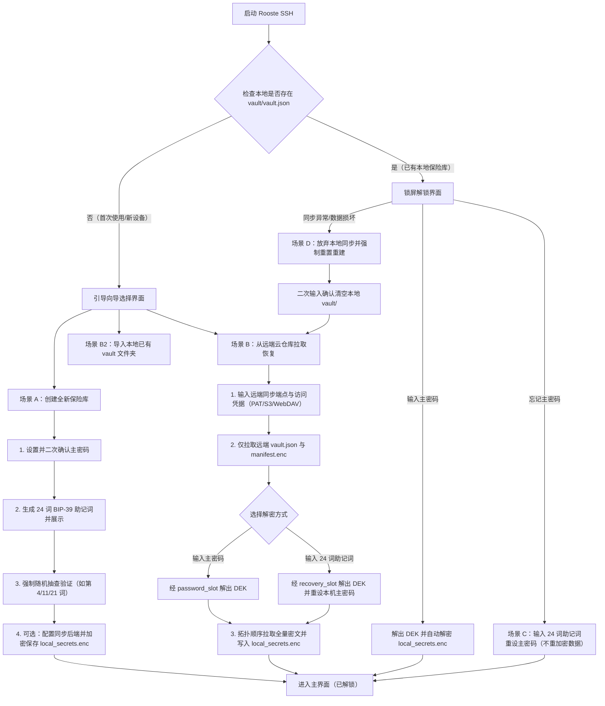

# Rooste SSH (`rooste-ssh`) — 加密保险库（Vault）与多端同步技术规范（最终定稿版 v2.0）

本文档定义 [`alexleft/rooste-ssh`](https://github.com/alexleft/rooste-ssh)（Rust 2024 Edition，`unsafe_code = "forbid"`）的纯文件型端到端加密保险库与多后端增量同步架构规范。

> [!IMPORTANT]
> **核心架构原则**
> 1. **零 OS Keyring 依赖**：彻底摒弃对操作系统原生钥匙串（Windows Credential Manager / macOS Keychain / Linux Secret Service）的强依赖，实现 100% 自包含、全平台一致、无头环境友好及 U 盘真便携。
> 2. **端到端零知识加密**：全量采用国密 **`SM4-GCM`** 与**确定性组合 Nonce**，远端存储（GitHub / S3 / WebDAV）仅保存密文与公开密钥信封头。
> 3. **安全与工程底线**：100% Pure Safe Rust（`unsafe_code = "forbid"`），所有敏感明文均通过 `zeroize` 严格清零；同步网络层全异步运行，严禁阻塞 `egui` UI 主线程。

---

## 1. 全平台存储分层与目录结构

### 1.1 各操作系统与便携模式根目录路径

系统自动检测运行环境并按以下优先级确定根目录 `<ROOSTE_ROOT>`：

| 运行模式 / 平台 | 检测条件与根目录路径 `<ROOSTE_ROOT>` | 说明 |
| :--- | :--- | :--- |
| **便携模式 (Portable)** | 可执行文件同级目录存在 `rooste-ssh.toml`、旧版 `rooste.toml` 或 `portable` 标记文件 → `<exe_dir>/` | 最高优先级；所有数据随 U 盘或便携文件夹移动，不写入宿主机系统目录。 |
| **Windows（标准）** | `%APPDATA%\rooste-ssh\`（典型路径 `C:\Users\<User>\AppData\Roaming\rooste-ssh\`） | 标准安装版默认路径。 |
| **macOS（标准）** | `~/Library/Application Support/rooste-ssh/` | 遵循 Apple 应用支持目录规范。 |
| **Linux / BSD（标准）** | `$XDG_CONFIG_HOME/rooste-ssh/`（未设置时回退为 `~/.config/rooste-ssh/`） | 遵循 XDG Base Directory 规范。 |

### 1.2 目录文件职责分层

根目录下的文件按“同步范围”与“机密级别”严格划分为四层：

```text
<ROOSTE_ROOT>/
│
├── config.toml                # 【跨平台系统偏好】UI 主题、字号、终端回溯行数、tmux 偏好设置
├── local.toml                 # 【本机专属状态 - 严格不同步】设备标识、本地路径、Nonce 计数器、同步端点与游标
├── local_secrets.enc          # 【本机加密凭据 - 严格不同步】由 DEK 派生密钥加密的同步后端凭据（替代 OS Keyring）
│
└── vault/                     # 【端到端加密保险库 - 同步根目录（本地与远端结构 1:1 一致）】
    ├── vault.json             # 密钥信封头（KDF 参数、主密码槽位、24 词 BIP-39 助记词恢复槽位）
    ├── manifest.enc           # 加密的全局增量索引表（逻辑版本号、时间戳、SHA-256、墓碑标记）
    ├── known_hosts.enc        # 加密的受信 SSH 服务端公钥指纹列表
    ├── profiles/
    │   └── <profile-uuid>.enc # 会话连接配置密文（通过 key_sha256 关联托管私钥）
    ├── passwords/
    │   └── <profile-uuid>.enc # 会话登录密码密文（与 Profile ID 一一对应，连接时按需解密）
    ├── keys/
    │   └── <key-sha256>.enc   # 托管 SSH 私钥密文（一等资产，以规范化内容 SHA-256 命名并全局去重）
    └── scripts/
        └── <script-uuid>.enc  # Rhai 自动化登录脚本密文
```

### 1.3 `local.toml`（本机专属状态，严格不参与同步）

`local.toml` 仅记录与当前机器硬件/文件系统相关的运行状态，**永远不会上传到远端仓库**：

```toml
# 当前设备全局唯一标识（首次运行时随机生成 UUIDv4）
device_id = "f81d4fae-7dec-11d0-a765-00a0c91e6bf6"
device_name = "Alex-Workstation"

# SM4-GCM 确定性 Nonce 单调递增计数器（每次加密前严格递增并原子刷盘）
nonce_counter = 1042

# 本机路径（便携模式下支持相对路径，如 "./downloads"；路径失效时自动回退至系统默认下载目录）
download_dir = "./downloads"
last_download_to = ""
log_dir = "./logs"
skipped_version = ""

# 空闲自动锁屏时间（秒），0 表示仅在退出时清理内存 DEK
auto_lock_timeout_secs = 1800

[sync]
enabled = true
backend = "github" # "none" | "github" | "s3" | "webdav"
endpoint = "https://api.github.com/repos/alexleft/rooste-vault-private"
branch = "main"
auto_sync_interval_secs = 300
last_synced_manifest_hash = "9f86d081884c7d659a2feaa0c55ad015"
last_synced_sequence = 48
```

### 1.4 替代 OS Keyring：`local_secrets.enc` 便携安全凭据方案

为彻底消除对宿主机 OS Keyring 的依赖（解决 U 盘跨机运行、Linux 无头环境及跨平台权限弹窗问题）：
* **日常解锁**：应用启动后由用户输入主密码解出主数据加密密钥 `DEK`，持有在受 `zeroize::Zeroizing<[u8; 16]>` 保护的内存中；支持按 `auto_lock_timeout_secs` 空闲自动锁屏清零。
* **云端同步凭据存储（标准模式与便携模式统一）**：
  * GitHub PAT、S3 AccessKey/SecretKey、WebDAV 密码等同步凭据**绝不写入 `local.toml` 明文**，而是序列化为 `LocalSyncCredentials` 后存入 `<ROOSTE_ROOT>/local_secrets.enc`。
  * 加密密钥由解锁后的 `DEK` 经 `HKDF-SHA256` 派生：`K_local = HKDF-SHA256(ikm = DEK, salt = device_id, info = b"rooste-ssh-local-secrets-v1")`。
  * 无论标准模式还是 U 盘便携模式，只要用户输入主密码解锁了保险库，应用即可自动解密 `local_secrets.enc` 获取同步凭据并立即开展云端同步；插拔 U 盘更换电脑完全无需重新配置 PAT 或 S3 密钥。

---

## 2. 密码学规范 (`crates/rooste-vault`)

全系统统一采用纯 Safe Rust 密码学组件（RustCrypto 生态）：
* **口令密钥派生（KDF）**：`Argon2id`（$m = 64\text{ MiB}, t = 3, p = 4$）。
* **密钥扩展与子密钥派生**：`HKDF-SHA256`。
* **内容寻址哈希**：`SHA-256`。
* **对称认证加密（AEAD）**：国密 **`SM4-GCM`**（基于 `sm4` 与 `aes-gcm::AesGcm<Sm4, U12>`，128-bit 密钥、96-bit Nonce、128-bit Tag）。
* **离线恢复助记词**：标准 **BIP-39 英文词表（24 个单词，256-bit 熵）**。

### 2.1 双槽密钥信封 (`vault/vault.json`)

保险库初始化时由 `OsRng` 随机生成 16 字节（128-bit）主数据加密密钥 **`DEK`**，同时生成 32 字节（256-bit）随机熵编码为 **24 个 BIP-39 英文助记词**。`DEK` 通过两个独立槽位加密保存于 `vault.json`：

1. **槽位 1：主密码槽 (`password_slot`)**
   * $\text{KEK}_{\text{pw}} = \text{Argon2id}(\text{password}, \text{salt}_{\text{pw}}, m=64\text{MB}, t=3, p=4) \rightarrow 16\text{ bytes}$
   * $\text{wrapped\_dek}_1 = \text{SM4-GCM}_{\text{KEK}_{\text{pw}}}(\text{nonce}_1, \text{AAD}=\text{"password\_slot:v1"}, \text{DEK})$
2. **槽位 2：助记词恢复槽 (`recovery_slot`)**
   * 从 24 个 BIP-39 英文单词校验并还原 32 字节原始熵 $\text{entropy}_{32}$。
   * $\text{KEK}_{\text{mnemonic}} = \text{HKDF-SHA256}(\text{ikm}=\text{entropy}_{32}, \text{salt}=\text{salt}_{\text{rec}}, \text{info}=\text{"rooste-vault-recovery-v1"}) \rightarrow 16\text{ bytes}$
   * $\text{wrapped\_dek}_2 = \text{SM4-GCM}_{\text{KEK}_{\text{mnemonic}}}(\text{nonce}_2, \text{AAD}=\text{"recovery\_slot:v1"}, \text{DEK})$

```rust
#[derive(Debug, Clone, Serialize, Deserialize)]
pub struct VaultHeader {
    pub version: u8,          // 固定为 1
    pub vault_id: String,     // 保险库唯一 UUID（用于防范跨库文件混用）
    pub kdf: Argon2Params,    // 持久化记录 m_cost, t_cost, p_cost 以便未来升级参数
    pub password_slot: KeySlot,
    pub recovery_slot: KeySlot,
}

#[derive(Debug, Clone, Serialize, Deserialize)]
pub struct KeySlot {
    pub salt: [u8; 16],
    pub nonce: [u8; 12],
    /// 经 SM4-GCM 加密后的 16 字节 DEK + 16 字节认证 Tag（共 32 字节）
    pub wrapped_dek: Vec<u8>,
}
```

### 2.2 SM4-GCM 确定性组合 Nonce 结构（根除碰撞风险）

鉴于 GCM 模式（96-bit Nonce）对 Nonce 复用零容忍，且在多端并发写入时纯随机 Nonce 存在生日碰撞边界隐患，本规范强制采用**确定性组合 Nonce 结构**：

```text
|<-------------- 12 Bytes (96-bit) SM4-GCM Nonce -------------->|
+-------------------------------+-------------------------------+
|    Device Prefix (4 Bytes)    |  Monotonic Counter (8 Bytes)  |
|   SHA-256(device_id)[0..4]    |   u64 Big-Endian (Strict ++)  |
+-------------------------------+-------------------------------+
```

* **跨设备隔离**：每台设备的 `device_id` 为独立随机生成的 UUIDv4，其 SHA-256 前 4 字节构成设备命名空间；多台设备即使在离线状态下使用同一 `DEK` 并发加密，也不会生成相同 Nonce。
* **本机严格单调**：每次执行加密前，将 `local.toml` 中的 `nonce_counter` 原子递增并立即通过临时文件 + 原子 rename 持久化（若系统崩溃恢复或克隆了整个目录，可通过重新生成 `device_id` 避免计数回退导致 Nonce 复用）。
* **槽位封装 Nonce**：`vault.json` 两个槽位仅在初始化/修改主密码时生成，使用 `OsRng` 随机生成 12 字节 Nonce（每把 KEK 使用独立随机盐派生，几乎只使用一次）。

### 2.3 单文件密文信封与规范化 AAD 防替换机制 (`.enc`)

所有 `.enc` 文件采用统一的 `EncryptedRecord` 信封结构：

```rust
#[derive(Debug, Clone, Copy, PartialEq, Eq, Serialize, Deserialize)]
#[serde(rename_all = "snake_case")]
pub enum RecordKind {
    Manifest = 1,
    KnownHosts = 2,
    Profile = 3,
    Password = 4,
    SshKey = 5,
    Script = 6,
}

#[derive(Debug, Clone, Serialize, Deserialize)]
pub struct EncryptedRecord {
    pub version: u8,           // 协议版本，固定为 1
    pub vault_id: String,      // 所属保险库 UUID
    pub id: String,            // 记录 UUID（对于 keys/<sha256>.enc 则为 64 位小写 hex）
    pub kind: RecordKind,
    pub revision: u64,         // 单调递增逻辑版本号（解决分布式时钟漂移）
    pub updated_at: u64,       // 最后修改 UTC 毫秒时间戳（仅作辅助参考与展示）
    pub base_hash: [u8; 32],   // 修改前基线版本的密文 SHA-256 哈希
    pub nonce: [u8; 12],       // 确定性组合 12-byte Nonce
    pub ciphertext: Vec<u8>,   // SM4-GCM 加密后的明文 JSON + 16-byte Tag
}
```

#### 规范化 AAD（Canonical AAD）构造规则
为防止恶意篡改元信息或**文件替换/重命名攻击**（例如将 `profiles/A.enc` 改名覆盖 `profiles/B.enc`），AAD 必须按以下二进制格式严格拼接：

$$\text{AAD} = \text{version (1B)} \mathbin{\Vert} \text{kind (1B)} \mathbin{\Vert} \text{vault\_id\_len (2B BE)} \mathbin{\Vert} \text{vault\_id} \mathbin{\Vert} \text{id\_len (2B BE)} \mathbin{\Vert} \text{id} \mathbin{\Vert} \text{revision (8B BE)} \mathbin{\Vert} \text{updated\_at (8B BE)} \mathbin{\Vert} \text{base\_hash (32B)}$$

**解密校验强约束**：
1. 读取 `<dir>/<filename>.enc` 时，校验 `record.id` 必须与 `<filename>` 完全一致，且 `record.vault_id` 等于当前解锁的 `VaultHeader.vault_id`。
2. 重建 Canonical AAD 并使用 `SM4-GCM` 验证 Tag 与解密，任何字段篡改或文件错位均立即拒绝解密并报错。

### 2.4 保险库密钥全量轮转（Vault Re-keying）

若用户的设备丢失或怀疑底层 `DEK` 已发生泄露，系统提供“安全轮转保险库密钥”功能：
1. 生成全新 `DEK_new` 与新的 24 词 BIP-39 助记词，要求用户完成新助记词验证。
2. 在临时目录使用 `DEK_new` 重新加密所有 `.enc` 文件、重签 `vault.json` 与 `local_secrets.enc`。
3. 原子替换本地 `vault/` 并将全量新密文作为一个新版本推送至远端，彻底作废旧密钥与旧助记词。

---

## 3. 核心数据模型与一等资产管理

### 3.1 SSH 私钥作为一等资产与 SHA-256 去重 (`vault/keys/<sha256>.enc`)

SSH 私钥不再依赖宿主机零散文件路径，而是作为保险库内的**一等独立资产（First-class Asset）**进行统一托管与跨端同步：

1. **导入标准化与去重**：
   * 用户在“密钥管理器”或会话配置中导入本地私钥（支持 OpenSSH 格式与 PuTTY `.ppk` v2/v3）或生成新密钥时，系统将其统一标准化为规范的 OpenSSH PEM 文本，计算内容 `SHA-256`（64 位小写十六进制）。
   * 若 `vault/keys/<sha256>.enc` 已存在，直接复用该密钥资产；否则封装为 `VaultSshKey` 加密入库。
2. **一等资产独立生命周期（严禁自动垃圾回收）**：
   * 私钥可以独立存在于密钥库中，**无需绑定任何 `Profile`**（例如通用堡垒机密钥、个人根密钥）。
   * 删除某个 `Profile` **绝不会**自动删除或标记其关联的私钥为墓碑；仅当用户在“密钥管理器”中显式点击删除并确认时，才将该密钥在清单中置为 `deleted = true`（若仍有 Profile 引用该密钥，UI 需列出受影响的会话列表供二次确认）。
3. **Passphrase 二次确认与连接期按需解密**：
   * 为私钥设置保护口令（Passphrase）或导入加密私钥时，UI **必须要求用户输入并二次确认 Passphrase**，并支持用户选择：
     * **托管口令**：将 Passphrase 随私钥密文一同加密保存于 `VaultSshKey`；
     * **每次连接二次认证（高安全模式）**：`require_passphrase_prompt = true`，不保存口令，每次发起 SSH 连接时弹窗要求输入 Passphrase 方可解锁私钥。
   * 软件启动时不解密私钥文件；仅在发起连接（或加载到内置 SSH Agent）瞬间按 `key_sha256` 解密，握手完成后立即触发 `Zeroize` 清空内存明文。

### 3.2 核心数据结构定义

```rust
/// 存储在 vault/profiles/<uuid>.enc 解密后的会话配置
#[derive(Debug, Clone, PartialEq, Serialize, Deserialize)]
pub struct Profile {
    pub id: String,
    pub name: String,
    pub folder: String,
    pub tags: Vec<String>,
    pub protocol: Protocol,
    pub host: String,
    pub port: Option<u16>,
    pub user: String,
    /// 关联的托管 SSH 私钥资产（对应 vault/keys/<key_sha256>.enc）
    pub key_sha256: Option<String>,
    pub use_agent: bool,
    /// 是否在 vault/passwords/<id>.enc 中保存了登录密码
    pub save_password: bool,
    pub allow_legacy: bool,
    pub proxy_jump: Option<String>,
    pub forward_agent: bool,
    pub forward_x11: bool,
    pub tmux_auto_attach: bool,
    pub tmux_session_name: String,
    /// 关联的 Rhai 脚本 UUID（对应 vault/scripts/<script_id>.enc）
    pub on_connect_script_id: Option<String>,
    pub tunnels: Vec<Tunnel>,
    pub serial: SerialSettings,
    pub notes: String,
}

/// 存储在 vault/keys/<key_sha256>.enc 解密后的托管 SSH 密钥（一等资产）
#[derive(Clone, Serialize, Deserialize, zeroize::Zeroize, zeroize::ZeroizeOnDrop)]
pub struct VaultSshKey {
    pub sha256: String,
    pub label: String,
    pub fingerprint: String,
    pub public_key: String,
    pub private_key_pem: zeroize::Zeroizing<String>,
    /// 若 require_passphrase_prompt 为 true，则此处恒为 None，连接时由用户交互输入
    pub passphrase: Option<zeroize::Zeroizing<String>>,
    pub require_passphrase_prompt: bool,
}

/// 存储在 vault/passwords/<profile-uuid>.enc 解密后的登录密码
#[derive(Clone, Serialize, Deserialize, zeroize::Zeroize, zeroize::ZeroizeOnDrop)]
pub struct VaultPassword {
    pub profile_id: String,
    pub password: zeroize::Zeroizing<String>,
}

/// 存储在 vault/manifest.enc 解密后的全局增量清单
#[derive(Debug, Clone, Serialize, Deserialize)]
pub struct VaultManifest {
    pub sequence: u64,
    pub updated_at: u64,
    /// 键为 "<kind>/<id>"（如 "profiles/3b24..."、"keys/e3b0c44..."）
    pub entries: std::collections::BTreeMap<String, ManifestEntry>,
}

#[derive(Debug, Clone, PartialEq, Eq, Serialize, Deserialize)]
pub struct ManifestEntry {
    pub id: String,
    pub kind: RecordKind,
    /// 该条目的逻辑修改版本号（单调递增，解决多端时钟漂移）
    pub revision: u64,
    pub updated_at: u64,
    /// 当前 .enc 文件的 SHA-256 哈希
    pub rev_hash: [u8; 32],
    /// 修改前基线版本的 SHA-256 哈希
    pub prev_hash: Option<[u8; 32]>,
    /// 软删除墓碑标记（仅由用户显式删除触发，保留 90 天后清理远端与本地墓碑）
    pub deleted: bool,
}
```

---

## 4. 用户交互流程与完整状态机（Onboarding & Recovery UX）

系统定义了 5 个核心交互闭环，覆盖首次初始化、日常加解锁、新设备恢复、忘记主密码以及灾难性强制重建。



### 场景 A：首次初始化与助记词强制备份
1. 用户输入主密码并进行二次确认（界面实时展示口令熵强度评估，推荐至少 12 位混合字符）。
2. 系统生成 `DEK` 与 24 个 BIP-39 英文助记词，以 `4 × 6` 网格清晰编号展示，并提供“复制到剪贴板（30 秒后自动清空）”及“隐藏/显示”开关。
3. **防跳过强制校验**：点击“我已安全抄写”后，进入校验页，系统随机抽取 3 个词位（如第 3 词、第 12 词、第 20 词）要求用户准确填入，校验通过后方正式落盘 `vault.json`。
4. 随后询问是否配置远端同步后端；若配置，连接测试成功后将同步凭据加密写入 `local_secrets.enc` 并执行首次推送。

### 场景 B：新设备接入与远端拉取恢复
1. 新设备（或新 U 盘）启动时检测到无 `vault/`，用户点击“从云端恢复保险库”。
2. 用户选择后端类型（GitHub / S3 / WebDAV）并填写端点地址与访问凭据（如 GitHub PAT）。
3. 客户端先仅下载远端 `vault.json` 与 `manifest.enc`，向用户展示已发现的远端保险库信息（包含会话数、密钥数、最后更新时间）。
4. 用户可选择**输入原有主密码**直接解锁，或点击**“使用 24 词助记词恢复”**（在忘记主密码时解出 DEK 并设定新主密码，随后回写更新远端 `vault.json`）。
5. 解锁成功后，客户端立即将云端凭据加密保存至本机 `local_secrets.enc`，并按拓扑顺序并发拉取所有加密数据，界面展示实时进度条。

### 场景 C：忘记主密码（本地无损重置）
1. 在解锁界面点击“忘记主密码？使用助记词恢复”。
2. 用户输入 24 个 BIP-39 助记词（支持逐词输入框与空格分隔整段粘贴，内置 BIP-39 拼写自动提示与校验和检查）。
3. 校验通过后从 `recovery_slot` 解出 `DEK`，提示用户输入并二次确认新主密码。
4. 系统使用新主密码重新计算 `Argon2id` 并覆写 `vault.json` 中的 `password_slot`，**无需重加密任何 `.enc` 数据文件**，随后同步更新远端 `vault.json`。

### 场景 D：放弃本地同步，清空本地数据并强制从远端重建（Wipe & Re-sync）
当本地加密文件因磁盘故障损坏、多端离线编辑产生严重分歧，或用户希望彻底舍弃本地未同步变更以远端为准时，可在“设置 → 同步与保险库”或锁屏界面触发**“重置本地保险库并从远端重新拉取”**：
1. **防误操作强提醒**：弹窗明确警告*“此操作将放弃所有本地未同步的修改，永久清除本机 `vault/` 目录下的所有加密文件，并要求重新通过助记词或主密码从远端拉取完整数据”*，要求用户输入确认词（如 `RESET`）。
2. **安全清理**：先将本地现有 `vault/` 移至临时回滚区 `vault.reset_backup/`（待远端全量拉取并解密校验通过后再彻底删除，防止网络中途断连导致无数据可用）。
3. **重新拉取与解密**：
   * 复用已配置的同步后端地址（或允许重新指定端点与凭据）。
   * 下载远端最新 `vault.json` 和 `manifest.enc`。
   * 用户输入 **24 词助记词**（或主密码）重新恢复 `DEK`。
   * 校验并全量拉取远端最新 `.enc` 快照，重建本地 `vault/`，重设 `local.toml` 中的 `last_synced_manifest_hash` 与新的 `device_id`（避免重启后的 Nonce 计数风险）。
4. **收尾**：全量校验无误后安全擦除临时回滚区 `vault.reset_backup/`，刷新主界面。

---

## 5. 全异步多后端增量同步引擎 (`crates/rooste-sync`)

### 5.1 异步非阻塞架构设计

为避免阻塞 `egui` 每秒 60 帧的渲染循环，**弃用同步阻塞式 `ureq`**，全面采用基于 `tokio` 的全异步同步架构：
* HTTP 客户端统一使用 `reqwest`（配置 `default-features = false, features = ["rustls-tls", "json"]`，保持 100% Pure Safe Rust）。
* 同步引擎作为独立 `tokio` 后台 Actor 运行，通过 `tokio::sync::mpsc` 接收来自 UI 的指令（手动同步、定时同步、配置测试、强制重置），并通过事件通道向 `egui` 推送同步状态、进度百分比与冲突提醒（触发 `ctx.request_repaint()`）。

### 5.2 统一异步后端接口 (`SyncBackend`)

```rust
#[async_trait::async_trait]
pub trait SyncBackend: Send + Sync {
    /// 获取远端文件及其版本标识（ETag / Git Blob SHA）
    async fn get_blob(&self, relative_path: &str) -> Result<Option<(Vec<u8>, String)>, SyncError>;

    /// 条件写入远端文件（携带 If-Match ETag 或 Git Ref 乐观锁）
    async fn put_blob(
        &self,
        relative_path: &str,
        data: &[u8],
        expected_etag: Option<&str>,
    ) -> Result<String, SyncError>;

    /// 批量原子提交（GitHub 后端覆盖此方法实现单次 Commit 原子写入）
    async fn commit_batch(
        &self,
        puts: Vec<(String, Vec<u8>)>,
        deletes: Vec<String>,
        expected_manifest_etag: Option<&str>,
    ) -> Result<String, SyncError>;

    /// 删除已过墓碑保留期的远端文件
    async fn delete_blob(&self, relative_path: &str) -> Result<(), SyncError>;
}
```

* **`GitHubBackend`**：基于 GitHub Git Database REST API（`blobs` → `trees` → `commits` → `refs`），将单次同步的所有 `.enc` 变更与 `manifest.enc` 打包为**单次原子 Git Commit**，通过更新 `refs/heads/<branch>` 的 Fast-Forward 校验实现天然乐观锁。
* **`S3Backend`**：纯 Rust 实现 AWS Signature V4（`sha2` + `hmac`），兼容 AWS S3、Cloudflare R2、MinIO、阿里云 OSS。先并发上传数据 `.enc` 对象，最后通过 `If-Match: <ETag>` 条件更新 `manifest.enc`。
* **`WebDavBackend`**：标准 HTTP `GET` / `PUT` / `MOVE` 对接群晖 NAS、Nextcloud、坚果云。写入采用先上传 `.tmp.<uuid>` 再原子 `MOVE` 覆盖的事务模式，结合 ETag 校验。

### 5.3 强一致性增量同步与冲突处理算法

1. **拉取校验 `manifest.enc`**：
   * 仅获取远端 `manifest.enc`（及 ETag）。若哈希与 `local.toml` 中的 `last_synced_manifest_hash` 一致且本地无待推送脏记录，直接结束（零额外流量消耗）。
2. **基于逻辑版本 (`revision`) 的三路合并（杜绝时钟漂移）**：
   * 对比每个条目在本地清单、远端清单与基线哈希的关系：
     * **仅远端更新**（`local.rev_hash == remote.prev_hash` 或本地无此记录）：加入下载队列 `to_pull`。
     * **仅本地更新**（`remote.rev_hash == local.base_hash` 或远端无此记录）：加入上传队列 `to_push`。
     * **并发修改冲突**（`remote.rev_hash != local.base_hash` 且 `local.rev_hash != remote.rev_hash`）：
       * 比较逻辑版本号 `revision`（若相等则退而比较 `updated_at`，仍相等则按 `device_id` 字典序确定胜出方，保证所有节点收敛一致）。
       * 胜出方保留原 UUID，败出方**自动分叉另存为新 UUID 的 `"<原名称> (冲突备份 - <日期>)"`**，并在 UI 状态栏弹出醒目通知供用户核对。
     * **软删除同步**：某端显式标记 `deleted = true` 且版本号更高时，另一端清理对应本地文件并同步墓碑记录；超过 90 天的墓碑在同步时顺带清理。
3. **两阶段拓扑应用（保障外键引用完整性）**：
   * **下载阶段**：严格按依赖拓扑顺序下载并先写入临时 staging 区——先处理 `keys/`、`passwords/`、`scripts/` 与 `known_hosts.enc`，全部解密校验完整后，再下载并激活 `profiles/`，彻底避免断网导致 Profile 引用缺失私钥而报错。
   * **上传阶段**：先并发上传依赖文件与 `profiles/` 密文，全部确认落盘后，最后一步原子提交新 `manifest.enc`（GitHub 后端则为单次 Commit）。
4. **乐观锁冲突自动重试（412 / Git Push Reject）**：
   * 当提交 `manifest.enc` 遇到并发竞争（S3 `412 Precondition Failed` 或 GitHub `422/409` 非快进错误）时：
   * 执行指数退避（随机抖动 `1s → 2s → 4s`，最多重试 3 次），自动重新执行“步骤 1 拉取 → 步骤 2 重做三路合并 → 步骤 3 提交”，无需人工干预。

---

## 6. 命令行客户端 (`rooste-cli`) 与旧版平滑迁移

### 6.1 无头环境 `rooste-cli` 适配

由于已完全移除 OS Keyring 依赖，`rooste-cli` 通过以下方式按优先级解锁保险库（纯只读/连接场景无需修改 `nonce_counter`）：
1. **环境变量（自动化/CI 推荐）**：读取 `ROOSTE_VAULT_PASSWORD` 环境变量直接派生 KEK 解出 `DEK`。
2. **密码文件参数**：支持 `--vault-password-file <path>`（校验 Unix 权限为 `0600`）。
3. **交互式终端输入**：使用 `rpassword` 在当前 TTY 隐藏回显提示用户输入主密码。

### 6.2 旧版本配置自动平滑迁移

当应用启动检测到旧版 `config.toml` 中存在明文 `[[profiles]]` 且尚未建立 `vault/` 目录时：
1. 自动启动**“保险库升级迁移向导”**（复用场景 A 的主密码设置与助记词备份校验）。
2. 自动将旧版 `[[profiles]]` 拆分为 `vault/profiles/<uuid>.enc`。
3. 自动扫描各 Profile 指向的本地私钥路径（`key_file`）：
   * 文件存在且可读：标准化为 PEM，计算 SHA-256 去重存入 `vault/keys/<sha256>.enc`，并回填 `profile.key_sha256`（若私钥带口令则提示用户输入以选择托管或标记二次确认）。
   * 文件已丢失或无权限：迁移报告中标黄提示，不阻断其余会话迁移。
4. 若检测到旧版本遗留的 OS Keyring 密码（仅在迁移阶段做一次性只读迁移提取），自动读取并加密写入 `vault/passwords/<uuid>.enc`，迁移后提示用户可安全清除旧 Keyring 条目。
5. 将原旧版 `config.toml` 备份为 `config.toml.legacy.bak`，并重写清理后的纯净 `config.toml` 与 `local.toml`。

---

## 7. 分阶段实施路线图

| 阶段 | 核心 Crate | 关键交付物与验收标准 |
| :--- | :--- | :--- |
| **Phase 1** | `crates/rooste-vault` | 实现 `VaultHeader` 双槽信封（`Argon2id` + BIP-39 24 词）、国密 `SM4-GCM` + 确定性组合 Nonce、Canonical AAD 校验、`local_secrets.enc` 凭据封装、`VaultManifest` 与全量 `Re-keying`；补齐单元测试与 `proptest` 模糊测试。 |
| **Phase 2** | `crates/rooste-core` | 落地全平台与 Portable 根目录探测；拆分 `config.toml` 与 `local.toml`；实现 SSH 私钥一等资产标准化与 SHA-256 去重入库；完成旧版配置平滑迁移器与 `rooste-cli` 无头解锁适配。 |
| **Phase 3** | `crates/rooste-sync` | 基于 `tokio` + 异步 `reqwest`（`rustls-tls`）实现 `GitHubBackend`、`S3Backend`、`WebDavBackend`；完成逻辑版本三路合并、两阶段拓扑提交与乐观锁退避重试引擎。 |
| **Phase 4** | `crates/rooste-ssh` | 实现 5 大交互状态机 UI（初始化与助记词强制抽查、解锁/自动锁屏、新设备云端恢复、强制重置重建、忘记密码重置）；集成托管密钥管理器（Passphrase 二次确认）与异步同步状态栏控件。 |
